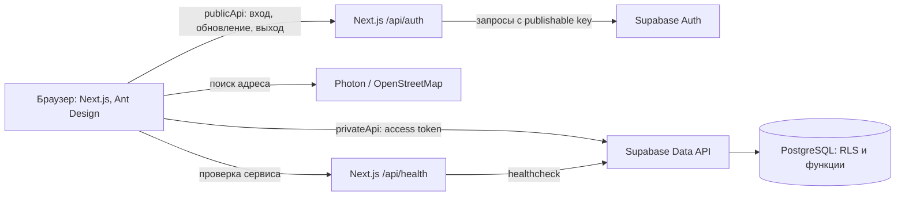
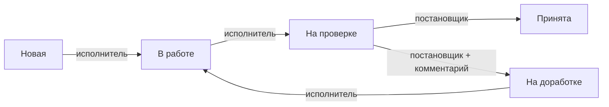

# Устройство мини-CRM

## Назначение и роли

Система связывает строительные объекты с задачами. Постановщик создаёт объекты, назначает задачи исполнителям и проверяет результат. Исполнитель работает только со своими задачами. Публичная регистрация отключена: учётные записи и роли добавляет администратор.

| Действие                                          | Постановщик    | Исполнитель                            |
| ------------------------------------------------- | -------------- | -------------------------------------- |
| Видеть объекты и задачи                           | Все активные   | Свои задачи и связанные с ними объекты |
| Создавать, менять и удалять объекты и задачи      | Да             | Нет                                    |
| Перевести задачу в работу и отправить на проверку | Нет            | Только свою                            |
| Принять или вернуть на доработку                  | Да, с проверки | Нет                                    |
| Менять принятую задачу                            | Нет            | Нет                                    |

Удаление объектов и задач логическое: они исчезают из рабочих списков, но история статусов остаётся в базе. У принятой задачи статус конечный, а редактирование запрещено и в интерфейсе, и в базе.

## Состав системы

- **Next.js** отдаёт страницы и маршруты авторизации. Страницы: вход, список объектов, карточка объекта, карточка задачи с историей и «Мои задачи».
- **Axios** разделён на `publicApi` для маршрутов входа и `privateApi` для запросов к Supabase Data API. Запись объектов, задач и статусов выполняется через функции БД (`/rpc/*`).
- **Zustand** хранит профиль, роль и состояние входа. Он не хранит refresh token.
- **Supabase Auth** проверяет логин и пароль. PostgreSQL хранит данные, проверяет права и фиксирует историю.
- **Photon / OpenStreetMap** предлагает варианты адреса в форме объекта; адрес можно ввести вручную.

## Данные и права

| Таблица               | Содержимое                                                                      |
| --------------------- | ------------------------------------------------------------------------------- |
| `profiles`            | Имя пользователя и роль; идентификатор связан с Supabase Auth.                  |
| `objects`             | Название, адрес и время создания/изменения/логического удаления.                |
| `tasks`               | Объект, название, описание, исполнитель, автор, статус и даты.                  |
| `task_status_history` | Кто, когда и с какого на какой статус перевёл задачу; комментарий при возврате. |

На всех четырёх таблицах включена RLS — проверка доступа к каждой строке. Постановщик видит все активные объекты и задачи; исполнитель видит только назначенные ему задачи, их объекты и историю. Профили доступны вошедшим пользователям для отображения авторов и выбора исполнителя.

У клиентской роли есть право чтения, но нет прямого права менять таблицы. Функции записи проверяют роль и пользователя внутри БД. Перевод статуса и добавление записи истории происходят в одной транзакции; историю нельзя править отдельным запросом. Функции создания и переноса задачи блокируют строку объекта, чтобы одновременное удаление не оставило активную задачу у удалённого объекта. Изменения схемы хранятся в [`supabase/migrations`](../supabase/migrations/); существующую облачную базу ради запуска проекта не сбрасывают.

## Основные сценарии

### Вход и сессия

1. Пользователь вводит логин и пароль. `POST /api/auth/login` обращается к Supabase Auth и возвращает короткоживущий access token; refresh token помещается в HttpOnly cookie.
2. Браузер держит access token только в памяти. `privateApi` добавляет его к запросам к Data API. После входа приложение получает профиль и роль через `current_profile`.
3. После перезагрузки страницы `POST /api/auth/refresh` восстанавливает access token из cookie. Одновременные запросы на обновление объединяются; при ответе `401` запрос может повториться с новым токеном.
4. `POST /api/auth/logout` отзывает сессию и очищает cookie. Маршруты авторизации проверяют `Origin`; cookie имеет `SameSite=Strict`, а при HTTPS — `Secure`.

### Работа с задачей

Постановщик создаёт объект и задачу, выбирает исполнителя. Создание задачи сразу добавляет первое событие истории. Исполнитель открывает «Мои задачи», берёт задачу в работу и отправляет на проверку. Постановщик принимает результат либо возвращает с обязательным комментарием. Каждый переход проверяется в функции `transition_task`; интерфейс только показывает доступные действия. Принятая задача остаётся доступной для просмотра, но её данные больше не редактируются.

## Где находится код

| Путь                                                          | Ответственность                                           |
| ------------------------------------------------------------- | --------------------------------------------------------- |
| [`src/app`](../src/app/)                                      | Страницы и маршруты `/api/auth/*`, `/api/health`.         |
| [`src/components`](../src/components/)                        | Навигация, формы, модальное окно инструкции, уведомления. |
| [`src/lib/auth`](../src/lib/auth/)                            | Сессия браузера, cookie и серверные запросы к Auth.       |
| [`src/lib/api`](../src/lib/api/)                              | Axios-клиенты и запросы профилей, объектов, задач.        |
| [`src/lib/store`](../src/lib/store/)                          | Состояние пользователя в Zustand.                         |
| [`supabase/migrations`](../supabase/migrations/)              | Версионированная схема, права, RLS и функции БД.          |
| [`supabase/tests`](../supabase/tests/) и [`tests`](../tests/) | Проверки БД, интерфейса и пользовательских сценариев.     |

## Проверки и сборка

Локально доступны `pnpm lint`, `pnpm typecheck`, `pnpm test`, `pnpm db:test`, `pnpm test:security`, `pnpm test:e2e` и `pnpm build`. Тесты БД и E2E используют локальный Supabase с данными от `pnpm seed:local`. GitHub Actions проверяет форматирование, типы, тесты, зависимости, миграции и права, затем параллельно собирает Next.js на Node 20 и 22 и запускает healthcheck. При изменении только документации тяжёлые сборки пропускаются.

## Решения и допущения

- «Удалить» означает логическое удаление, чтобы не терять историю. Принятую задачу нельзя редактировать, но постановщик может логически удалить её при очистке тестовых данных.
- Вошедшие пользователи видят имена и роли коллег для назначения и отображения автора; email в профилях не хранится.
- Формы используют Ant Design Form. Подсказки адреса берутся из внешнего Photon/OpenStreetMap с русской локализацией. Сервис может быть недоступен или предложить неточный адрес, поэтому ручной ввод разрешён.
- Тесты CI работают с отдельной локальной базой. Рабочую Supabase не сбрасывают; для неё применяют только новые миграции.
- Дополнительные тесты, CI и подсказки адреса выполнены сверх минимального объёма ТЗ. Незавершённых обязательных функций в текущей реализации нет.
